<h1 align="center">Hi, I'm Mehmet Faruk Aydın 👋</h1>

  <b>Software Developer · Product & Technology Lead</b> 
  I build web, mobile & desktop products — marketplaces, payment & loyalty systems, automation and AI.

  
  
  

---

## 🧭 About me

I'm a software developer and technology lead. I design and build the **full stack of a product** — backend architecture and the algorithms & business logic underneath, admin panels, REST APIs, and the mobile apps and web platforms that sit on top of them. My real strength is **complex problem‑solving at the seams**: making mobile apps and web systems behave as one coherent product, with payment, wallet and loyalty logic, data sync and automation running reliably behind the scenes.

At **BuyKibris.com** I led both general management and software development for a multi‑tenant platform with **10,000+ members and 300+ partner stores** — building the web infrastructure, admin panels, a modular feature system, REST APIs and the Android/iOS apps, plus the digital discount‑card, wallet and loyalty‑point engines. Alongside this I've founded my own startups, delivered client projects end‑to‑end, and built in‑house **AI** products.

- 🏗️ **End‑to‑end engineering** — backend architecture, algorithms & business logic, admin panels, REST APIs
- 🔗 **Complex problem‑solving across mobile & web** — integration, real‑time sync, automation between apps and platforms
- 💳 **Fintech‑style systems** — payment, wallet, loyalty & discount‑card engines
- 🤖 **In‑house AI products** — human‑simulation AI, a developer/security AI agent, AI‑assisted sales
- 🌍 Ran tech & operations at international events (TEKNOFEST, World Cups, Islamic Solidarity Games)

---

## 🛠️ Tech Stack

**Languages**

**Backend & Frameworks**

**Frontend & Mobile**

**Databases**

**AI / ML**

**Tools & DevOps**

---

## 🚀 Featured Projects

A selection of the products I've designed and built. Click a live site to open it.

<table>
<tr>
<td width="50%" valign="top">
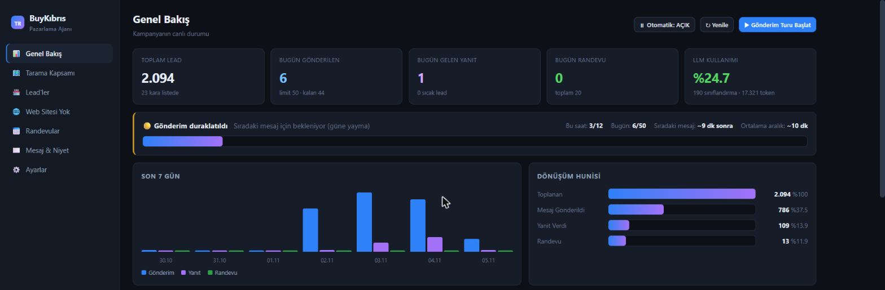
</td>
<td width="50%" valign="top">
<h3>📈 BuyKibris Marketing Agent</h3>
An autonomous <b>AI sales & outreach agent</b> — discovers businesses from maps, flags the ones with no website, classifies intent with an LLM, then writes and sends personalized messages, follows up and books appointments automatically. Live <b>lead → message → reply → appointment</b> funnel across <b>2,000+ leads</b>, with background workers, rate‑limited sending and a blacklist.
  <b>Python · SQLite · Celery/Redis · Google Maps · LLM</b>
</td>
</tr>

<tr>
<td width="50%" valign="top">
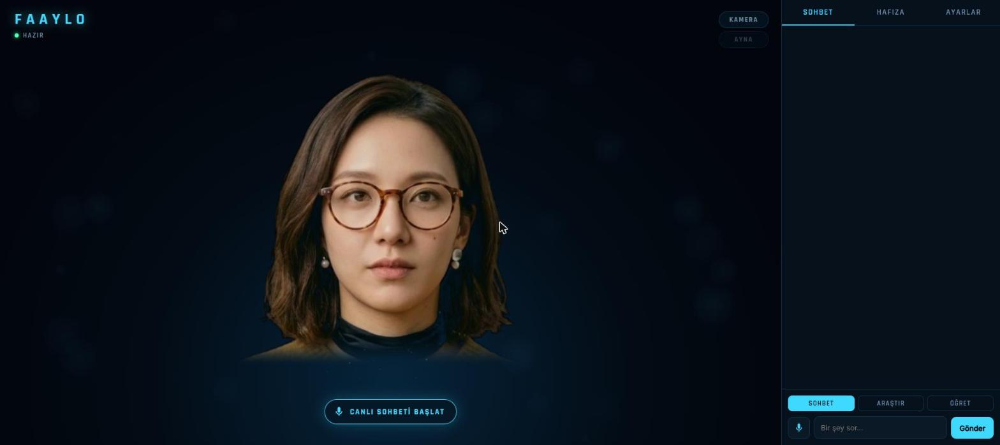
</td>
<td width="50%" valign="top">
<h3>🪩 Faaylo — Conversational Digital Human</h3>
A real‑time <b>holographic AI persona</b>. Faaylo renders a lifelike face (WebGL) with live <b>Wav2Lip</b> lip‑sync, speaks with offline or neural TTS, listens continuously and senses when you've finished talking, <b>sees you</b> through the camera (local MediaPipe face tracking — video never leaves the device) and mirrors your head movements, and <b>remembers</b> you via a semantic memory it builds from conversation. Runs fully offline on local LLMs.
  <b>FastAPI · WebGL · Wav2Lip (CUDA) · MediaPipe · local LLMs</b>
</td>
</tr>

<tr>
<td width="50%" valign="top">
<a href="https://buykibris.com">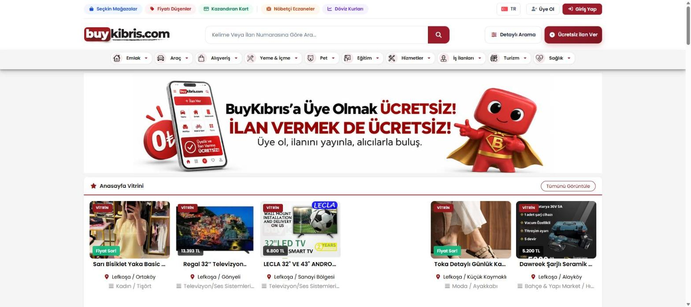</a>
</td>
<td width="50%" valign="top">
<h3>🛒 <a href="https://buykibris.com">BuyKibris.com</a></h3>
Cyprus's classifieds & shopping marketplace — <b>10,000+ members, 300+ partner stores</b>. Web platform, admin panels, modular features, plus Android & iOS apps. Includes digital discount card, wallet and loyalty‑point systems.
  <b>PHP · JavaScript · MySQL · REST API · Android/iOS</b>
</td>
</tr>

<tr>
<td width="50%" valign="top">
<a href="https://biletcik.com">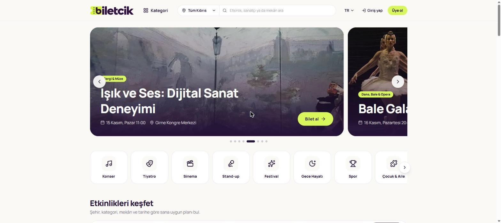</a>
</td>
<td width="50%" valign="top">
<h3>🎟️ <a href="https://biletcik.com">Biletcik.com</a></h3>
Event ticketing platform for Cyprus — concerts, theatre, cinema, festivals and more. Category browsing, event discovery and online ticket purchase.
  <b>PHP · JavaScript · MySQL</b>
</td>
</tr>

<tr>
<td width="50%" valign="top">
<a href="https://buymedya.com">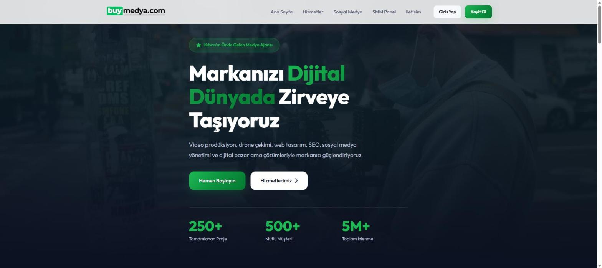</a>
</td>
<td width="50%" valign="top">
<h3>🎬 <a href="https://buymedya.com">BuyMedya.com</a></h3>
Digital media agency platform — video production, drone shooting, web design, SEO and social‑media management, with an SMM service panel.
  <b>PHP · JavaScript · MySQL · SMM Panel</b>
</td>
</tr>

<tr>
<td width="50%" valign="top">
<a href="https://kktcevarkadasi.com">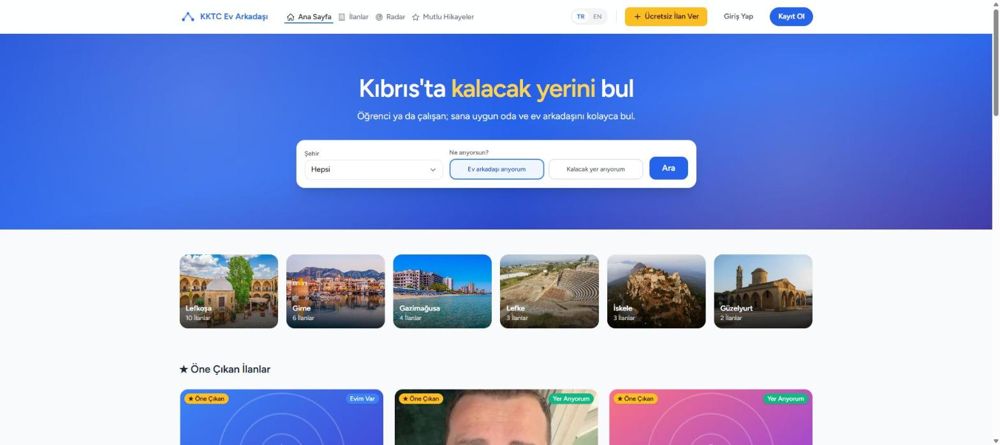</a>
</td>
<td width="50%" valign="top">
<h3>🏠 <a href="https://kktcevarkadasi.com">KKTC Ev Arkadaşı</a></h3>
Roommate & housing platform for students and workers in North Cyprus — city‑based listings, "looking for a place / looking for a roommate" matching and a map radar.
  <b>PHP · JavaScript · MySQL</b>
</td>
</tr>

<tr>
<td width="50%" valign="top">
<a href="https://kktcsikayet.com">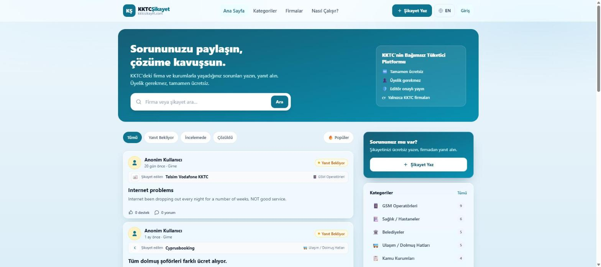</a>
</td>
<td width="50%" valign="top">
<h3>📣 <a href="https://kktcsikayet.com">KKTC Şikayet</a></h3>
Independent consumer‑complaints platform for North Cyprus — users post issues with companies, businesses respond, editor‑approved and free to use.
  <b>PHP · JavaScript · MySQL</b>
</td>
</tr>

<tr>
<td width="50%" valign="top">
<a href="https://cckiklimlendirme.com">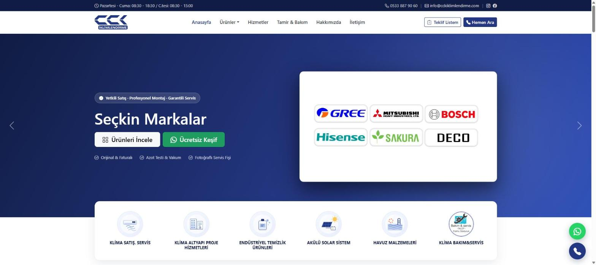</a>
</td>
<td width="50%" valign="top">
<h3>❄️ <a href="https://cckiklimlendirme.com">CCK İklimlendirme</a></h3>
Client project — air‑conditioning sales, installation, maintenance and technical‑service company site with product catalog, service requests and quote basket.
  <b>Client Web · Catalog · Quote System</b>
</td>
</tr>
</table>

---

## 📱 Mobile Apps

Native mobile apps where a lot of the real engineering lives — syncing with the web backend over REST APIs, offline‑friendly flows, QR and in‑app wallets.

### 🛍️ BuyKibris — Marketplace & Wallet App
The BuyKibris marketplace in your pocket: browse 10,000+ listings across categories, post free ads, scan store QR codes, and manage an in‑app **points wallet** with earn/spend history and withdrawal requests.

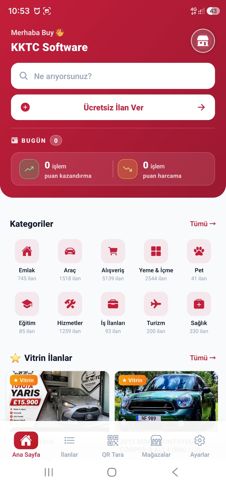&nbsp;&nbsp;&nbsp;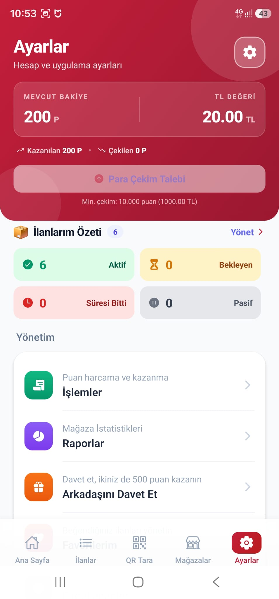

<b>React Native / Expo · REST API · Wallet & loyalty points</b>

### 🔧 Technical‑Service Field App
A field app for service technicians: a guided **9‑step job flow** (installation / repair / maintenance), shift tracking, stock entry and job history — built for on‑site teams.

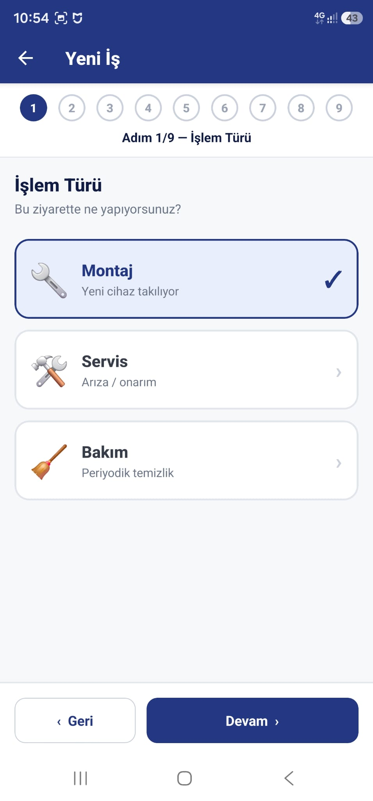&nbsp;&nbsp;&nbsp;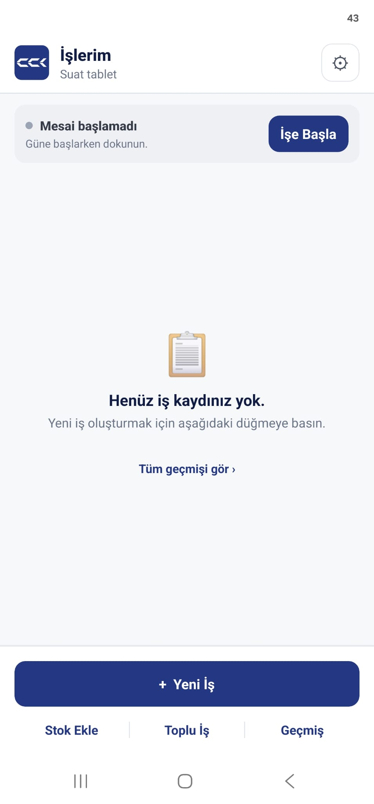

<b>Mobile · Field service · Job management</b>

---

## 🤖 AI & Automation

More in‑house AI I've built:

### 🛡️ Kodcu — Developer & Security AI Agent
An autonomous **coding agent** I built to develop and audit my own software. It plans, writes and refactors code across projects, runs commands, researches the web, and learns durable lessons and reusable **skills** from feedback. Ships with skills for web apps, databases/admin panels, debugging, Git and **secure coding**, runs high‑security **penetration‑style code reviews**, verifies its own work before finishing, and runs free & offline on local models — or connects to Claude/Gemini.
 <b>Node.js · Local LLMs (Ollama) · Claude/Gemini · SQLite</b>

### 🏢 Emlak Yönetim — Real‑Estate AI Assistant
An AI assistant for real‑estate operations — organizing portfolios and listings and streamlining day‑to‑day agency workflows.

### 🎯 AI Sales & Field Tracking
Activity tracking, performance analysis and AI‑assisted evaluation for sales & marketing teams.

---

## 🧰 More Software & Systems

Shipped across many sectors — web, mobile & desktop:

- 💠 **ApexonSoft** — digital product studio: corporate sites, e‑commerce, mobile apps & custom software ([apexonsoft.com](https://apexonsoft.com))
- 🗳️ **Hasan Tosunoğlu** — political candidate campaign website, client project ([hasantosunoglu.com](https://hasantosunoglu.com))
- 🧾 **Accounting Desktop App** — accounting, personnel and business‑operations management
- 🚗 **Rent‑a‑Car Reservation System** — booking, scheduling & online payment for car‑rental businesses
- 🍽️ **Restaurant QR‑Menu & Website** — digital menus and websites for restaurants
- 🤝 **SosyalBot** — human‑like automation that posts cars & property to large Facebook groups automatically
- 🧳 **Yoldostum** — travel‑companion platform matching people on similar routes
- 💬 **Messaging Automation** — WhatsApp/Telegram notifications & cross‑platform workflow integrations
- 📨 **Bulk SMS & Email · Raffle tools · DomainHunter** — campaign messaging, prize‑draws and domain research

---

## 💼 Experience

- **General Manager & Software Developer** — *BuyKibris.com* · 2025–2026
- **Software Manager** — *Turkish Modern Pentathlon Federation* · 2018–2024
- **Founder & Software Lead** — *Milano Design & Ad Agency* · 2017–2018
- **Technical Consultant** — *Bimeks* · 2015
- **Computer & Programming Instructor** — *Public Education Centers & KOMEK* · 2011–2018

**Education:** Management Information Systems (Anadolu Üniv., 2021) · Computer Programming (Selçuk Üniv., 2014)

**Certifications:** C#, Advanced Java, Advanced Python, Microsoft Power BI, Business Analysis (BTK, 2025) · ISO 27001 & Project Management (2024)

---

## 📫 Connect

- 💻 GitHub: [@mefaay](https://github.com/mefaay)
- 🌐 Live products: see the sections above
- 📍 Nicosia, North Cyprus

---

<i>💬 Open to Software Developer / Tech Lead roles — remote or on‑site. Feel free to reach out!</i>

